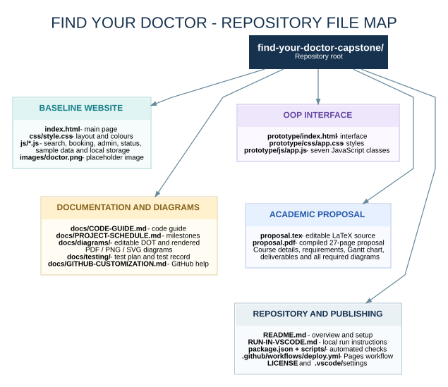

# Find Your Doctor
### Tangail Doctor Directory and Appointment Booking Prototype

A capstone project for **Software Engineering and Project Management Lab (ICT 3108)**. This repository contains the browser-based doctor-finder website, a separate object-oriented prototype, the project proposal in editable LaTeX and PDF formats, the required UML/analysis diagrams, schedule, and test/run documentation.

> **Project status:** The delivered application is a browser-side prototype. Appointment records are stored in the current browser, and the bundled doctor/facility listings and schedules are sample data that require verification before any real operational use. Do not enter real patient information into this demo.

## Student and course details

| Field | Details |
|---|---|
| Submitted by | **Md. Khalid Hasan** |
| Student ID | **IT24013** |
| Course title | Software Engineering and Project Management Lab |
| Course code | ICT 3108 |
| Submitted to | Professor Dr. Ziaur Rahman |
| Department | Information and Communication Technology |
| University | Mawlana Bhashani Science and Technology University |
| Proposal version | 1.0 - Initial capstone proposal |
| Planning window | 2 November 2026 - 15 January 2027 (proposed) |

## Main files

- **[Project proposal (PDF)](proposal.pdf)** - ready to read and review.
- **[Editable LaTeX source](proposal.tex)** - edit the proposal and compile a new PDF.
- **[Project code guide](docs/CODE-GUIDE.md)** - baseline website structure and file responsibilities.
- **[VS Code run instructions](RUN-IN-VSCODE.md)** - run the site locally.
- **[Project completion schedule](docs/PROJECT-SCHEDULE.md)** - milestones, deliverables and planning weeks.
- **[Diagram index](docs/diagrams/README.md)** - editable diagram sources and renderings.
- **[GitHub customization guide](docs/GITHUB-CUSTOMIZATION.md)** - repository setup, Pages publishing and editing advice.
- **[Test plan](docs/testing/TEST-PLAN.md)** and [manual test record](docs/testing/MANUAL-TEST-RESULTS.md).

## Repository file diagram



A text view of the main folders:

```text
find-your-doctor-capstone/
├── index.html                   # Main doctor finder website
├── css/
│   └── style.css                # Main website styles
├── js/                          # Search, booking, status, admin and data modules
├── images/
│   └── doctor.png               # Doctor placeholder image
├── prototype/                   # Additional interface for the OOP class requirement
│   ├── index.html
│   ├── css/app.css
│   └── js/app.js                 # Seven JavaScript classes
├── docs/
│   ├── diagrams/                # Editable .dot + rendered PDF, PNG and SVG
│   ├── testing/                 # Test plan and manual test record
│   ├── CODE-GUIDE.md
│   ├── PROJECT-SCHEDULE.md
│   ├── GITHUB-CUSTOMIZATION.md
│   └── repository-structure.svg / .png / .dot
├── proposal.tex                 # Editable capstone proposal
├── proposal.pdf                 # Compiled proposal
├── README.md
├── RUN-IN-VSCODE.md
├── package.json                 # Local automated test commands
└── .github/workflows/deploy.yml # GitHub Pages workflow
```

## Features in the baseline website

- Filter the doctor directory by hospital, department, speciality, and doctor name.
- View doctor cards, profile details, and visit schedules from the bundled dataset.
- Demonstrate date selection, patient form validation, local appointment references and serial numbers.
- Review stored appointment status through the prototype's lookup flow.
- Print or download an appointment slip; PDF export depends on the optional jsPDF CDN library.
- Demonstrate admin actions for managing appointments, exporting records, and backing up/restoring browser data.
- Export appointment records to XLSX when SheetJS is available, with a CSV fallback.
- Save the demo's records in browser `localStorage`.

The supplied code guide describes 235 doctor/facility entries across 11 facilities. Treat those records as unverified sample data until validated with authorized sources.

## OOP interface: seven implemented classes

Open [`prototype/index.html`](prototype/index.html) with VS Code Live Server. This additional interface demonstrates seven JavaScript classes represented by the UML class diagram:

1. `Doctor`
2. `Patient`
3. `Appointment`
4. `DoctorDirectory`
5. `LocalStorageRepository`
6. `AppointmentService`
7. `PrototypeUI`

The interface supports doctor search, selecting a doctor, validating a sample appointment, assigning a demo reference/serial, saving data locally, and listing saved demo appointments. It uses a separate local-storage key from the baseline app. Use synthetic test values only.

## Required diagrams

The `docs/diagrams/` directory contains editable Graphviz `.dot` sources and rendered `.pdf`, `.png`, and `.svg` files:

- Data Flow Diagram - context / Level 0
- Data Flow Diagram - Level 1
- Use Case Diagram
- Activity Diagram - appointment booking
- Entity-Relationship Diagram
- UML Class Diagram
- UML Object Diagram

**Model boundary:** The DFDs represent the browser-side prototype. The ERD is a proposed data model for a future server-backed implementation; it does not mean that database tables already exist in this project.

## Run locally

### Main website

1. Download/extract the repository ZIP, or clone it from GitHub.
2. Open the `find-your-doctor-capstone` folder in VS Code.
3. Install the **Live Server** extension if needed.
4. Right-click the root `index.html` and select **Open with Live Server**.
5. Keep the folder structure intact so that the linked CSS, JavaScript, and image paths continue to work.

### OOP interface

Start Live Server on `prototype/index.html`. Run it from inside the repository because it loads the doctor dataset using `../js/data.js`.

Detailed steps are in [RUN-IN-VSCODE.md](RUN-IN-VSCODE.md).

## Run automated checks

Install Node.js, open a terminal in the repository root, then run:

```bash
npm run check
npm test
```

- `npm run check` checks JavaScript syntax.
- `npm test` runs the dependency-free OOP smoke tests for search, input validation, booking, date/capacity rules, and cancellation logic.

Also complete the manual browser checklist in `docs/testing/MANUAL-TEST-RESULTS.md` before claiming full manual verification.

## Compile the proposal PDF

Install a LaTeX distribution such as TeX Live or MiKTeX. From the repository root, run:

```bash
pdflatex proposal.tex
pdflatex proposal.tex
```

The second compilation updates table-of-contents and page references. The existing `proposal.pdf` is already included.

To regenerate diagram images after editing a Graphviz `.dot` file, install Graphviz and run from `docs/diagrams/`:

```bash
for f in *.dot; do
  base="${f%.dot}"
  dot -Tpdf "$f" -o "$base.pdf"
  dot -Tpng -Gdpi=180 "$f" -o "$base.png"
  dot -Tsvg "$f" -o "$base.svg"
done
```

## Upload this project to your GitHub repository

### Method A - using Git from VS Code (recommended)

1. Sign in at [GitHub](https://github.com/) and create a **new empty repository** named `find-your-doctor-capstone`. Do not initialize it with a README, license, or `.gitignore` because those files are already included here.
2. Extract this ZIP and open the extracted `find-your-doctor-capstone` folder in VS Code.
3. Open **Terminal → New Terminal** and run these commands one by one, replacing `YOUR-USERNAME` with your GitHub username:

   ```bash
   git init
   git add .
   git commit -m "Add Find Your Doctor capstone project"
   git branch -M main
   git remote add origin https://github.com/YOUR-USERNAME/find-your-doctor-capstone.git
   git push -u origin main
   ```

4. Refresh the repository page on GitHub. The source code, PDF proposal, diagrams and README should now appear.

If `git` is not recognized, install Git for Windows and restart VS Code. If Git asks you to authenticate, complete the browser-based sign-in prompt. Never put a password or access token into a source file.

### Method B - upload files in the GitHub website

1. Create a repository on GitHub.
2. Open the repository and choose **Add file → Upload files**.
3. Upload the *contents* of the extracted project folder (including `.github` if the uploader permits it), not just the ZIP file.
4. Enter a commit message and click **Commit changes**.

Git is recommended because it preserves the directory structure and makes later updates easier. If the website uploader does not include hidden `.github` files, use Method A to push the repository instead.

## Publish the website with GitHub Pages

The included workflow is `.github/workflows/deploy.yml`. After pushing to the `main` branch:

1. Open the repository on GitHub.
2. Go to **Settings → Pages**.
3. Under **Build and deployment**, choose **GitHub Actions** as the source.
4. Open the **Actions** tab and wait for the Pages workflow to finish successfully.
5. Open the published URL shown by the deployment workflow and verify the pages.

For a repository named `find-your-doctor-capstone`, expected URLs are:

```text
https://YOUR-USERNAME.github.io/find-your-doctor-capstone/
https://YOUR-USERNAME.github.io/find-your-doctor-capstone/prototype/
```

Replace `YOUR-USERNAME` with your real username, and confirm the exact URL generated in the Actions/Pages interface before submitting. The package is ready for you to push, but it has not been pushed to a GitHub account or published from this environment. See [GitHub's Pages documentation](https://docs.github.com/en/pages).

## How to customize the project on GitHub

Use [docs/GITHUB-CUSTOMIZATION.md](docs/GITHUB-CUSTOMIZATION.md) for step-by-step instructions. Common edits:

| You want to change... | Edit this file |
|---|---|
| Student/course details in the proposal | `proposal.tex`, then compile the PDF |
| Details shown in this README | `README.md` |
| Website name and page title | Root `index.html` |
| Website colours, spacing and cards | `css/style.css` |
| Doctor/facility sample entries | `js/data.js` |
| Doctor placeholder image | `images/doctor.png` |
| OOP prototype layout/behaviour | `prototype/index.html`, `prototype/css/app.css`, `prototype/js/app.js` |
| Project timeline | `docs/PROJECT-SCHEDULE.md` and the Gantt chart section in `proposal.tex` |
| Diagram content | The relevant `.dot` file in `docs/diagrams/` |

Editing a file directly on GitHub is possible: open the file, click the pencil icon, make the change, then select **Commit changes**. To change several files, clone/pull the project, edit locally, test it, and push the commit.

## Known implementation boundaries

- Browser `localStorage` data is local to a browser origin and is not shared across devices.
- The demo admin flow is client-side; production authentication and authorization are not implemented.
- Doctor/facility names and schedules are bundled sample data and need independent verification.
- No live hospital system, SMS, email, payment, or clinical-system integration is connected.
- A production release would require a backend, shared database, server-side validation, access controls, audit logging, backup and recovery, monitoring, verified data, and institutional approval.

## License

This academic repository is provided under the MIT License in [`LICENSE`](LICENSE). Third-party libraries loaded from CDNs retain their own licenses.
